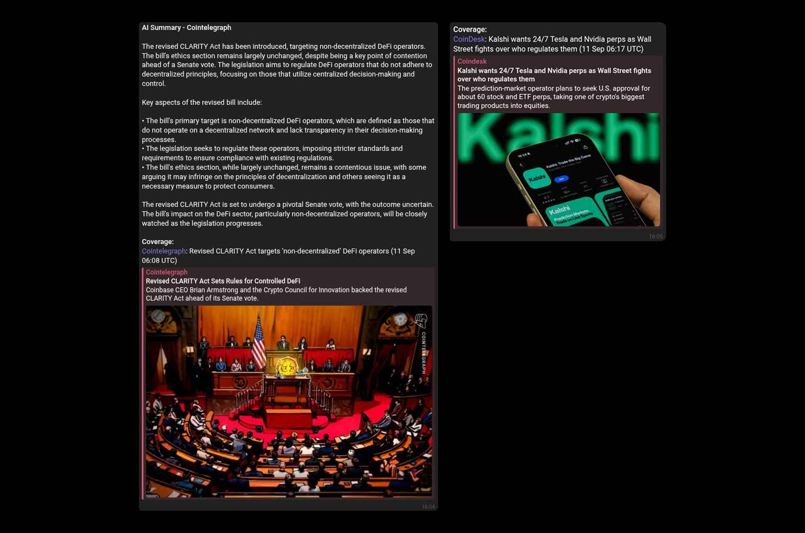
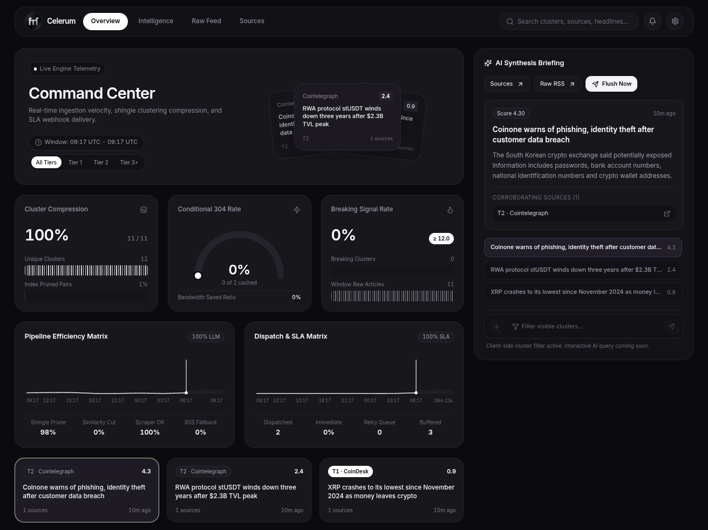
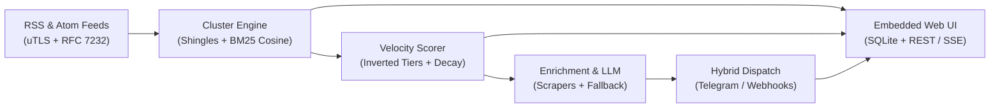
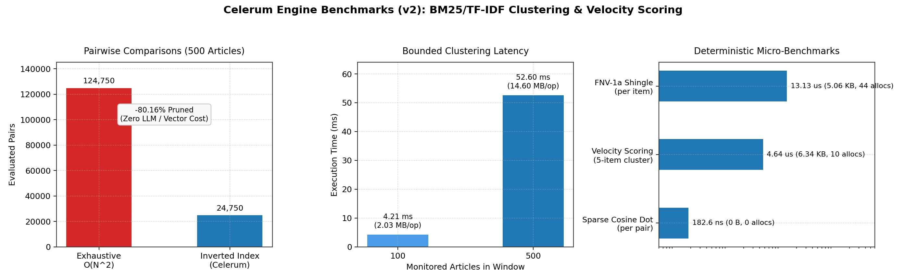

# Celerum

[](https://github.com/rafifmsn/celerum/actions/workflows/ci.yml)
[](https://go.dev/)
[](LICENSE)

A self-hosted, deterministic news intelligence engine written in Go with an embedded real-time web dashboard.
Celerum collects high-volume RSS and Atom feeds with Chrome TLS fingerprinting (`utls`) and RFC 7232 HTTP conditional polling (`304 Not Modified`).
Instead of relying on costly vector embeddings, Celerum uses token shingling, inverted index candidate pruning, local BM25/TF-IDF cosine similarity, bounded agglomerative merging, and Disjoint-Set Union (Union-Find) clustering.
Top-scoring breaking event clusters are optionally enriched and summarized via an LLM, served over a REST and SSE dashboard, and dispatched to Telegram or HTTP webhooks.



## Key Features

- **RFC 7232 Conditional Ingestion & Adaptive Scheduling:**
  Tracks `ETag`, `Last-Modified`, `Retry-After`, and `Cache-Control: max-age` headers in embedded SQLite (`sources`).
  TLS handshakes mimic a modern Chrome ClientHello via `utls`, and unmodified `304 Not Modified` feeds back off exponentially up to 30 minutes (`1.5^consecutive_304`) with randomized jitter.

- **Algorithmic Clustering (Zero Embedding Costs):**
  Cleans HTML and URLs, strips stop-words, applies lightweight stemming, and builds 64-bit FNV-1a unigram/bigram shingles alongside BM25/TF-IDF vectors weighted 2x toward headlines.
  An inverted shingle index prunes candidate pairs sharing fewer than 2 shingles before computing normalized cosine similarity with centroid and complete-linkage guards to prevent mega-cluster chaining.

- **Inverted Tier Velocity Scoring & Exponential Decay:**
  Heuristic scoring rewards unique source corroboration (`3.0`), inverted publisher tiers (`Tier 1 = 4.5`, `Tier 2 = 3.0`, `Tier 3+ = 1.5`), and word-boundary keyword boosts (`2.0`) scaled by an exponential half-life time decay (`HalfLifeHours = 2.0`).

- **Hybrid Alert Cadence & Persistent Delivery:**
  Clusters crossing `breaking_threshold` alert immediately while lower-scoring top-K clusters buffer for the periodic flush interval (`flush_interval`).
  Delivered SHA-256 cluster fingerprints persist in `dispatched_clusters`, and failed webhook or Telegram deliveries queue in `webhook_retries` for automatic background retry with exponential backoff.

- **Resilient AI Synthesis & Enrichment:**
  Supports OpenRouter, DeepSeek, OpenAI, Groq, and Ollama through OpenAI-compatible `/chat/completions` endpoints, paired with `none`, `direct`, `jina`, or `firecrawl` article scrapers.
  Strict config validation catches missing API keys early, while runtime provider timeouts fall back cleanly to raw RSS links (`enriched: false`) so breaking alerts are never dropped.

- **Zero-CGO Embedded Dashboard & Storage:**
  Single Go binary with `modernc.org/sqlite` storage (dual 7-day time TTL plus per-feed and global row caps) and a React SPA compiled into `web/dist` via `go:embed`.
  Runtime settings, feed sources, live SSE telemetry (`/api/events`), and 6-stage pipeline diagnostics (`doctor`) are manageable directly from the browser.

## Web Dashboard

Running `celerum run` starts both the background pipeline and an embedded web UI (`http://localhost:8080` by default) backed by SQLite, REST endpoints, and live SSE telemetry.



The dashboard includes views for Overview telemetry and AI synthesis briefings, Intelligence cluster inspection, paginated Raw Feed browsing, Sources health and YAML import/export, Dispatch queues and history, and live Settings with inline System Doctor checks (additional captures are stored under [docs/screens/](docs/screens/)).

## Architecture Overview



**How it works:**

1. **uTLS Conditional Ingestion & Adaptive Polling:**
   Enabled feeds from SQLite `sources` are polled concurrently using cached `ETag` and `Last-Modified` cursors.
   When a feed returns `304 Not Modified`, Celerum honors `Retry-After` / `Cache-Control` hints or backs off by `1.5^consecutive_304` (capped at 30 minutes) with 10 percent jitter, resetting immediately when new articles arrive.
   Blocklisted URLs and empty titles are dropped while keeping up to `max_articles_per_feed` items per feed cycle, including short breaking headlines in raw storage.

2. **Shingle Pruning & Bounded TF-IDF Clustering:**
   Articles with at least 4 non-stopword tokens enter an in-memory clustering window where title and description tokens are stemmed and hashed into sorted 64-bit FNV-1a shingles.
   An inverted shingle index skips pairs with fewer than 2 shared shingles before scoring candidate pairs using L2-normalized BM25/TF-IDF vectors (title terms weighted 2x) and merging strongest pairs with Union-Find, a centroid guard (`0.85 * threshold`), and a complete-linkage floor (`0.60 * threshold`).

3. **Inverted Tier Velocity Scoring:**
   Clusters are scored across unique sources rather than duplicate feed items, giving Tier 1 wires higher authority than Tier 2 or Tier 3+ feeds and applying word-boundary keyword matching and a 2-hour half-life exponential decay.

4. **Hybrid Alert Cadence & Persistent Deduplication:**
   Clusters meeting `breaking_threshold` are dispatched immediately, while remaining top-K clusters are held as buffered candidates until the `flush_interval` timer fires or an operator triggers a manual flush.
   Every dispatched cluster writes its SHA-256 URL-set fingerprint to `dispatched_clusters` in SQLite to prevent duplicate alerts across restarts.

5. **Constrained Enrichment, Fallback & Retry Queue:**
   When LLM synthesis is enabled, Celerum optionally scrapes up to 3 articles per cluster concurrently (15-second timeout) using `direct`, `jina`, or `firecrawl`, then invokes `/chat/completions` (30-second timeout).
   If scraping or summarization fails, alerts still ship with RSS metadata (`enriched: false`), and failed webhook or Telegram HTTP deliveries persist in `webhook_retries` for background retry (or manual retry from the UI).

For the full mathematical formulation, database schema, and API overview, see [docs/architecture.md](docs/architecture.md).
For scraper trade-offs, config precedence, and operational limits, see [docs/limitations.md](docs/limitations.md).

## Quickstart

1. **Build the frontend and Go binary:**

   ```bash
   npm --prefix web install && npm --prefix web run build
   go build -o celerum ./cmd/celerum
   ```

   If `web/dist` is already built and committed or up to date, `go build -o celerum ./cmd/celerum` embeds it directly.

2. **Initialize configuration and environment (optional):**

   ```bash
   ./celerum init
   cp .env.example .env
   ```

   Celerum automatically loads `.env` from the config directory on startup.
   You can also skip `celerum.yaml` entirely for a zero-config first boot and configure feeds, keys, and targets directly in the web dashboard, because SQLite becomes the runtime source of truth once seeded.

3. **Run non-destructive pipeline diagnostics:**

   ```bash
   ./celerum doctor -c celerum.yaml
   ```

   `doctor` runs a 6-stage verification (config validation, SQLite WAL storage, feed reachability, article scraper, LLM `/chat/completions`, and dispatch targets).
   Pass `--send` to deliver a synthetic test alert through configured dispatchers, or use `./celerum test telegram` for Telegram-only verification.

4. **Dry-run clustering check (zero external cost):**

   ```bash
   ./celerum check -c celerum.yaml
   ```

   Polls active feeds once and prints formed clusters and velocity scores to stdout without dispatching alerts or calling an LLM.

5. **Start the engine and web dashboard:**

   ```bash
   ./celerum run -c celerum.yaml -addr :8080
   ```

   Open `http://localhost:8080` in your browser to monitor live telemetry, inspect raw articles and clusters, manage sources, or hot-reload settings without restarting.
   Pass `-c` only when you want to bootstrap or overwrite SQLite configuration from YAML, because bare `./celerum run` resumes directly from the SQLite database.

## Production Deployment

For 24/7 operation on a server or VPS, run Celerum via Docker Compose with persistent `./data` volume storage.

1. **Prepare environment and optional seed config:**

   ```bash
   cp .env.example .env
   cp celerum.yaml.example celerum.yaml
   ```

   Expose port `8080` (or reverse-proxy port `8080` behind Nginx or Caddy) if you want remote access to the web dashboard.

2. **Start the container stack:**

   ```bash
   docker compose up -d
   ```

3. **Inspect logs or stop the service:**

   ```bash
   docker compose logs -f celerum
   docker compose down
   ```

## Configuration Reference

Celerum uses `celerum.yaml` as an initial bootstrap seed (and for UI YAML import/export).

```yaml
version: "1"

database:
  path: "data/celerum.db"

engine:
  poll_interval: "5m"
  window_duration: "3h"
  flush_interval: "1h"
  max_articles_per_feed: 20
  similarity_threshold: 0.28
  breaking_threshold: 12.0
  top_k: 5

feeds:
  - name: "CoinDesk"
    url: "https://www.coindesk.com/arc/outboundfeeds/rss/"
    category: "Crypto"
    tier: 1
    enabled: true
  - name: "Cointelegraph"
    url: "https://cointelegraph.com/rss"
    category: "Crypto"
    tier: 2
    enabled: true

keywords:
  boost:
    - "etf"
    - "sec"
    - "fed"
    - "ath"
    - "acquisition"
  blocklist:
    - "/sponsored/"
    - "/press-releases/"

enrichment:
  scraper: "none" # none | direct | jina | firecrawl
  jina_api_key: "${JINA_API_KEY}"
  firecrawl_api_key: "${FIRECRAWL_API_KEY}"

llm:
  enabled: true
  provider: "openrouter" # openrouter | deepseek | openai | groq | ollama
  base_url: "" # optional, defaults to provider endpoint
  model: "meta-llama/llama-3.1-8b-instruct"
  api_key: "${LLM_API_KEY}"
  language: "en"
  system_prompt: "" # optional custom prompt with {{language}} placeholder

dispatch:
  telegram:
    enabled: true
    bot_token: "${TELEGRAM_BOT_TOKEN}"
    chat_id: "${TELEGRAM_CHAT_ID}"
  webhook:
    enabled: false
    url: "https://example.com/api/news"
    headers:
      Authorization: "Bearer ${WEBHOOK_SECRET}"
```

## Testing

Run the automated test suite across all packages:

```bash
go test -v ./...
```

## Benchmarks

Celerum avoids neural embeddings and vector databases in favor of deterministic lexical shingling, BM25/TF-IDF cosine clustering, and HTTP conditional caching.
The engine clusters 100 active articles in ~4.21 ms (`2.03 MB / op`) and scales to 500 articles in ~52.60 ms (`14.60 MB / op`), including inverted index pruning, centroid checks, and complete-linkage guards.
All algorithmic benchmarks below are 3-run medians measured on Go 1.25+ on an AMD Ryzen 5 6600H CPU without external network, SQLite, or LLM dependencies.



### Performance Highlights

| Component / Operation          | Benchmark Metric | Allocations / Memory              | Engineering Impact                                                              |
| :----------------------------- | :--------------- | :-------------------------------- | :------------------------------------------------------------------------------ |
| **Sparse Cosine Dot**          | 182.6 ns / op    | 0 B / op, 0 allocs / op           | Zero heap allocation dot product across L2-normalized BM25/TF-IDF vectors       |
| **Velocity Scoring (5 items)** | 4.64 us / op     | 6.34 KB / op, 10 allocs / op      | Unique-source deduplication, inverted tier weights, keyword, and decay scoring  |
| **Shingle & Token Hash**       | 13.13 us / op    | 5.06 KB / op, 44 allocs / op      | FNV-1a 64-bit unigram and bigram hashing with stop-word stripping and stemming  |
| **Cluster Corpus (100 items)** | 4.21 ms / run    | 2.03 MB / op, 11,333 allocs       | Full BM25/TF-IDF clustering with centroid and complete-linkage guards           |
| **Cluster Corpus (500 items)** | 52.60 ms / run   | 14.60 MB / op, 52,350 allocs      | Bounded multi-source coverage deduplication and Union-Find merging              |
| **Inverted Index Pruning**     | 80.16% pruned    | Evaluated 24,750 of 124,750 pairs | Bypasses pairwise cosine scoring when documents share fewer than 2 shingles      |

### Reproduce Benchmarks

Run the benchmark suite and pruning verification locally:

```bash
# Run micro-benchmarks with memory profiling across clustering and scoring
go test -bench=. -benchmem -count=3 ./internal/cluster ./internal/score

# Measure inverted index pairwise pruning efficiency
go test -v -run TestPruningEfficiency ./internal/cluster
```

## Operational Tuning

Balancing freshness against multi-source corroboration depends on the velocity of your monitored feeds.
Below is an architectural breakdown of buffer dynamics and recommended tuning profiles.
Please note that this case study is provided for architectural reference and educational modeling only.

### Buffer Dynamics & Exponential Decay

When a high-volume publisher like Bloomberg produces 18 articles in a 5-minute cycle:

1. **Ring Buffer Quota:**
   All 18 articles fit within the feed buffer (`max_articles_per_feed: 20`).
2. **Active Window Accumulation:**
   The articles enter the active window (`window_duration: 3h`, or longer windows like `24h` via settings) stored across SQLite and memory.
3. **Cluster Formation & Multi-Source Lag:**
   If none of those 18 articles cross `breaking_threshold: 12.0` (because they are single-source stories without enough cross-publisher corroboration yet), they wait in the window for corroboration.
   If Reuters or CoinDesk publishes a matching story 15 minutes later, bounded BM25/TF-IDF cosine clustering merges it into Bloomberg's cluster, bumping the score and potentially triggering an immediate breaking alert.
4. **Exponential Time Decay:**
   The longer a cluster sits without fresh updates, the more its velocity score decays multiplicatively via $0.5^{\Delta t / 2.0}$ (see [docs/architecture.md](docs/architecture.md)).
   After 2 hours without corroboration, an unverified story drops to 50 percent of its base score, naturally yielding to fresh events.

### Fast-Paced Market Feeds

For fast-moving domains such as financial markets, commodities, or crypto, the default 1-hour heartbeat digest may feel delayed for actionable monitoring.
A tighter configuration profile prioritizes immediacy:

```yaml
engine:
  poll_interval: "2m" # Poll feeds every 2 minutes with adaptive 304 backoff
  window_duration: "1h" # Expire uncorroborated stories after 60 minutes
  flush_interval: "15m" # Flush top-K digest every 15 minutes instead of 1 hour
  breaking_threshold: 14.0 # Multi-source Tier-1 alerts alert immediately
  top_k: 3 # Keep periodic digest payloads short and focused
```

- 15-Minute Digest Cadence ensures monitoring desks receive timely market digests without waiting an hour during quiet cycles.
- Tighter 1-Hour Window ensures stale single-source noise exits the active cluster evaluation promptly after 60 minutes.
- A breaking Tier-1 wire reported by two distinct Tier-1 outlets scores $(2 \times 3.0) + (2 \times 4.5) = 15.0$ before keyword boosts, immediately crossing `14.0` and delivering as soon as polled rather than waiting for any flush timer.

## Limitations & Edge Cases

- **Strict Scraper & LLM Key Validation:**
  Selecting `jina`, `firecrawl`, or non-`ollama` LLM providers enforces non-empty API keys at config save and `doctor` verification rather than failing silently.

- **Direct Scraper (`scraper: direct`):**
  Performs basic HTTP GET requests and HTML tag stripping without domain-level rate-limiting, IP rotation, or JavaScript hydration.
  Target publishers fronted by strict WAFs or Cloudflare may return HTTP 403 or 429 status codes.

- **YAML Bootstrap vs SQLite Runtime State:**
  Once seeded in SQLite, UI source/setting edits modify SQLite directly while `celerum.yaml` on disk remains unchanged unless exported via `/api/config/yaml`.

For detailed edge cases and recommended mitigations, refer to [docs/limitations.md](docs/limitations.md).
