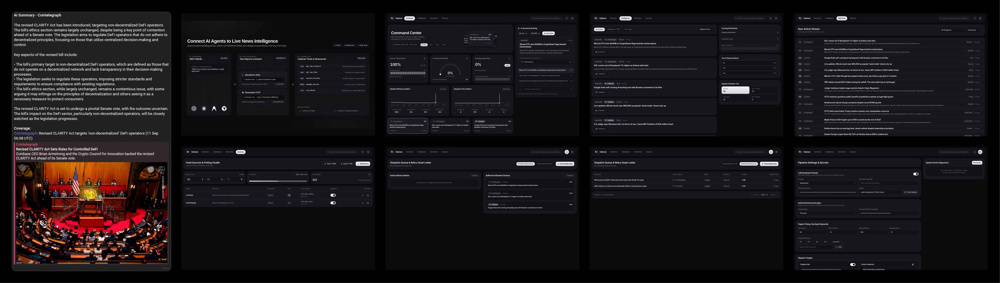
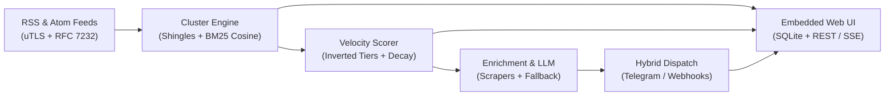

<p align="center">
  
</p>

<p align="center">
  <a href="https://github.com/rafifmsn/celerum/actions/workflows/ci.yml">
    
  </a>
  <a href="https://go.dev/">
    
  </a>
  <a href="./LICENSE">
    
  </a>
</p>

<p align="center">
  Celerum collects high-volume RSS and Atom feeds with Chrome TLS fingerprinting and RFC 7232 HTTP conditional polling. Instead of relying on costly vector embeddings, it uses token shingling, inverted index candidate pruning, local BM25/TF-IDF cosine similarity, bounded agglomerative merging, and Disjoint-Set Union clustering. Top-scoring breaking event clusters are optionally enriched and summarized via an LLM, served over a REST and SSE dashboard, and dispatched to Telegram or HTTP webhooks.
</p>

<p align="center">
  <a href="#key-features">Key Features</a> ·
  <a href="#dashboard">Dashboard</a> ·
  <a href="#architecture">Architecture</a> ·
  <a href="#quickstart">Quickstart</a> ·
  <a href="#deployment">Deployment</a> ·
  <a href="#testing">Testing</a> ·
  <a href="#benchmarks">Benchmarks</a>
</p>

## Key Features

- **Conditional Polling:** Chrome TLS fingerprinting (`utls`) and RFC 7232 `ETag`/`Last-Modified` cursors with `304` backoff up to 30 minutes.
- **Zero-Embedding Clustering:** Stop-word stripping, stemming, 64-bit FNV-1a shingle pruning, and BM25/TF-IDF cosine clustering with Union-Find and linkage guards.
- **Velocity Scoring:** Scores unique-source corroboration weighted by inverted publisher tiers (`Tier 1` > `Tier 2` > `Tier 3+`), keyword boosts, and a 2-hour half-life decay.
- **Hybrid Dispatch & Retries:** Immediate alerts above `breaking_threshold`, periodic `flush_interval` digests for top-K clusters, SQLite deduplication, and exponential-backoff retries.
- **AI Enrichment with Safe Fallback:** OpenAI-compatible `/chat/completions` (OpenRouter, DeepSeek, OpenAI, Groq, Ollama) paired with `none`, `direct`, `jina`, or `firecrawl` scrapers; falls back to raw RSS links on timeout.
- **Single-Binary UI & Storage:** Zero-CGO SQLite (`modernc.org/sqlite`) with 7-day retention and an embedded React + SSE dashboard (`/api/events`).
- **MCP Server:** Exposes `get_top_clusters`, `get_raw_feed`, `search_articles`, `manage_sources`, and `run_doctor` plus `celerum://feeds` and `celerum://clusters/latest` over stdio (`celerum mcp`, `--read-only`) or `/mcp` (`--mcp-read-only`).

## Dashboard

Running `celerum run` starts both the background pipeline and an embedded web UI (`http://localhost:8080` by default) backed by SQLite, REST endpoints, and live SSE telemetry. The dashboard includes views for Overview telemetry and AI synthesis briefings, Intelligence cluster inspection, paginated Raw Feed browsing, Sources health and YAML import/export, Dispatch queues and history, and live Settings with inline System Doctor checks (additional captures are stored under [docs/screens/](docs/screens/)).



## Architecture



**How it works:**

1. **Poll & Filter:** Active `sources` are fetched concurrently with `uTLS` and cached `ETag`/`Last-Modified` headers; `304` responses back off exponentially, while blocklisted URLs and empty titles are dropped.
2. **Cluster:** Articles with 4+ non-stopword tokens are stemmed and hashed into FNV-1a shingles; pairs sharing 2+ shingles are scored via BM25/TF-IDF cosine similarity (2x headline weight) and merged using Union-Find with centroid (`0.85x`) and complete-linkage (`0.60x`) guards.
3. **Score:** Clusters are ranked by unique-source corroboration, inverted publisher tiers, word-boundary keyword boosts, and a 2-hour half-life decay.
4. **Enrich (Optional):** Clusters can scrape up to 3 articles (`direct`, `jina`, or `firecrawl`, 15s timeout) and summarize via `/chat/completions` (30s timeout), falling back to raw RSS links on failure.
5. **Dispatch & Retry:** Breaking clusters send immediately and remaining top-K clusters flush on `flush_interval`; SHA-256 URL-set fingerprints in `dispatched_clusters` prevent duplicates and failed deliveries queue in `webhook_retries`.

For the full mathematical formulation, database schema, and API overview, see [docs/architecture.md](docs/architecture.md).
For scraper trade-offs, config precedence, and operational limits, see [docs/limitations.md](docs/limitations.md).

## Quickstart

1. **Build frontend & Go binary** (Docker builds both automatically via [Dockerfile](Dockerfile)):

   ```bash
   npm --prefix web install && npm --prefix web run build
   go build -o celerum ./cmd/celerum
   ```

2. **Initialize config & env (optional):**

   ```bash
   ./celerum init
   cp .env.example .env
   ```

   You can skip `celerum.yaml` and configure everything in the dashboard, or inspect [celerum.yaml.example](celerum.yaml.example) for all fields.

3. **Verify & dry-run (optional):**

   ```bash
   ./celerum doctor -c celerum.yaml   # 6-stage check (add --send for a test alert)
   ./celerum check -c celerum.yaml    # dry-run clustering without dispatching or LLM calls
   ```

4. **Start engine & dashboard:**

   ```bash
   ./celerum run -c celerum.yaml -addr :8080
   ```

   Open `http://localhost:8080`. `-c` seeds SQLite on first boot only; after that `./celerum run` resumes from SQLite (use `./celerum import -c celerum.yaml` or `Sources -> Import YAML` to overwrite from YAML).

5. **Connect an AI agent via MCP (optional):**

   ```bash
   ./celerum mcp -c /path/to/celerum.yaml --read-only
   ./celerum mcp --db /path/to/data/celerum.db --read-only   # or set CELERUM_DB
   ```

   Relative `database.path` entries resolve against `-c`'s directory, and `celerum mcp` fails fast outside a configured directory without `-c`, `--db`, or `CELERUM_DB`. Streamable HTTP is also mounted at `/mcp` during `celerum run` (`--mcp-read-only` disables `manage_sources`).

## Deployment

For 24/7 operation on a server or VPS, run Celerum via Docker Compose with persistent `./data` volume storage.

1. **Prepare environment and optional seed config:**

   ```bash
   cp .env.example .env
   cp celerum.yaml.example celerum.yaml
   ```

   Expose port `8080` (or reverse-proxy port `8080` behind Nginx or Caddy) if you want remote access to the web dashboard.

2. **Start the container stack:**

   ```bash
   docker compose up -d
   ```

3. **Inspect logs or stop the service:**

   ```bash
   docker compose logs -f celerum
   docker compose down
   ```

## Testing

Run the automated test suite across all packages:

```bash
go test -v ./...
```

## Benchmarks

Celerum avoids neural embeddings and vector databases in favor of deterministic lexical shingling, BM25/TF-IDF cosine clustering, and HTTP conditional caching.
The engine clusters 100 active articles in ~4.21 ms (`2.03 MB / op`) and scales to 500 articles in ~52.60 ms (`14.60 MB / op`), including inverted index pruning, centroid checks, and complete-linkage guards.
All algorithmic benchmarks below are 3-run medians measured on Go 1.25+ on an AMD Ryzen 5 6600H CPU without external network, SQLite, or LLM dependencies.


### Performance Highlights

| Component / Operation          | Benchmark Metric | Allocations / Memory              | Engineering Impact                                                              |
| :----------------------------- | :--------------- | :-------------------------------- | :------------------------------------------------------------------------------ |
| **Sparse Cosine Dot**          | 182.6 ns / op    | 0 B / op, 0 allocs / op           | Zero heap allocation dot product across L2-normalized BM25/TF-IDF vectors       |
| **Velocity Scoring (5 items)** | 4.64 us / op     | 6.34 KB / op, 10 allocs / op      | Unique-source deduplication, inverted tier weights, keyword, and decay scoring  |
| **Shingle & Token Hash**       | 13.13 us / op    | 5.06 KB / op, 44 allocs / op      | FNV-1a 64-bit unigram and bigram hashing with stop-word stripping and stemming  |
| **Cluster Corpus (100 items)** | 4.21 ms / run    | 2.03 MB / op, 11,333 allocs       | Full BM25/TF-IDF clustering with centroid and complete-linkage guards           |
| **Cluster Corpus (500 items)** | 52.60 ms / run   | 14.60 MB / op, 52,350 allocs      | Bounded multi-source coverage deduplication and Union-Find merging              |
| **Inverted Index Pruning**     | 80.16% pruned    | Evaluated 24,750 of 124,750 pairs | Bypasses pairwise cosine scoring when documents share fewer than 2 shingles      |

### Reproduce Benchmarks

Run the benchmark suite and pruning verification locally:

```bash
# Run micro-benchmarks with memory profiling across clustering and scoring
go test -bench=. -benchmem -count=3 ./internal/cluster ./internal/score

# Measure inverted index pairwise pruning efficiency
go test -v -run TestPruningEfficiency ./internal/cluster
```
