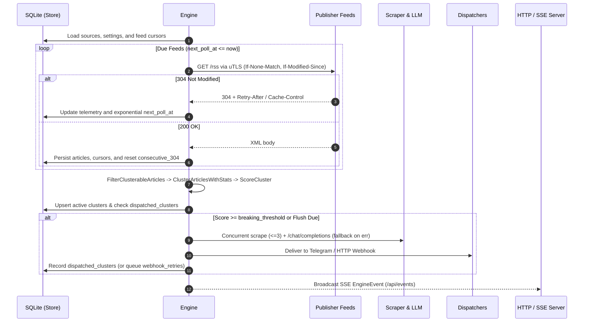
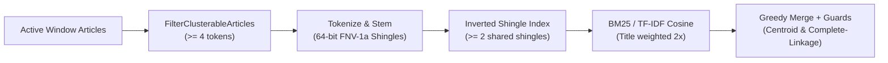

# Celerum Architecture & Technical Specification



## Design Principles

Celerum is built as a single zero-CGO Go binary combining scheduled RSS/Atom ingestion, deterministic clustering, hybrid alerting, and an embedded React SPA served over standard `net/http`.
Rather than depending on vector databases or embedding APIs, the pipeline keeps similarity and scoring deterministic, self-contained in memory, and persisted in SQLite (`modernc.org/sqlite` in WAL mode).

## Ingestion & Adaptive Polling (`internal/feed`, `internal/engine`)

Polling high-frequency publishers uniformly wastes bandwidth and invites rate limits.
Celerum implements conditional caching paired with browser-aligned TLS transport and per-feed adaptive intervals:

- **uTLS Transport (`utlsRoundTripper`):**
  HTTPS requests use `utls.HelloChrome_Auto` with ALPN negotiation (`h2` and `http/1.1`) and Chrome-aligned headers to improve compatibility with CDN-fronted syndication endpoints.
- **RFC 7232 Conditional Requests:**
  Feed polling cursors (`etag`, `last_modified`) persist in the SQLite `sources` table via `Store.UpdateSourcePollTelemetry`.
  Conditional `If-None-Match` and `If-Modified-Since` headers trigger `304 Not Modified` responses with zero XML body transfer when feeds have not changed.
- **Adaptive Per-Feed Backoff (`computeAdaptiveDelay`, `ParseRetryAndCacheHeaders`):**
  Feeds returning `304` or HTTP errors increment `consecutive_304` and back off by `1.5^consecutive_304` times `poll_interval` (capped at `30m`), while honoring explicit `Retry-After` or `Cache-Control: max-age` response headers and applying 10 percent jitter.
  When new articles arrive, `consecutive_304` resets to `0`.
- **Raw Feed Preservation (`FilterAndCap`):**
  Only empty titles and URLs matching `keywords.blocklist` are excluded at ingest, capped at `max_articles_per_feed` items per poll cycle.
  Short breaking headlines remain persisted in SQLite for the Raw Feed UI even if they are filtered out downstream during clustering.

## Shingle Pruning & Bounded TF-IDF Clustering (`internal/cluster`)

Multi-source news clustering uses lexical shingling, inverted-index pruning, and bounded agglomerative merging in `ClusterArticlesWithStats`:



1. **Pre-Filter & Normalization:**
   `FilterClusterableArticles` excludes ultra-short items with fewer than 4 non-stopword tokens before clustering.
   Remaining headlines and the first 25 description tokens are stripped of HTML/URLs, lowercased, stripped of stop-words, and suffix-stemmed (`Stem`).
   Title and combined token sequences produce sorted 64-bit FNV-1a unigram/bigram `ShingleHashes`.
2. **Inverted Index Candidate Pruning:**
   An inverted shingle map links each hash to matching document indices.
   Only pairs sharing at least 2 shingles proceed to cosine evaluation, avoiding $O(N^2)$ full scoring.
3. **Local BM25 / TF-IDF Cosine Similarity:**
   Each document builds smoothed IDF weights $1 + \ln((N + 1) / (\text{df} + 1))$ and BM25 term-frequency scaling with $k_1 = 1.2$, weighting title terms `2.0x` relative to description terms `1.0x` and L2-normalizing sparse vectors.
   Candidate similarity evaluates `max(combinedCosine, titleCosine * 0.92)` against `similarity_threshold` (default `0.28`).
4. **Bounded Agglomerative Union-Find:**
   Qualifying pairs are sorted descending by similarity and merged via `DisjointSet` only when combined cluster size stays within `50` items, cluster centroid cosine meets `0.85 * threshold`, and all cross-cluster member pairs meet a complete-linkage floor of `0.60 * threshold`.
   This prevents transitive `A-B-C` chaining into unrelated mega-clusters.

## Inverted Tier Velocity Scoring (`internal/score`)

`Scorer.ScoreCluster` evaluates corroboration breadth, inverted publisher authority, keyword boosts, and exponential decay:

$$S(C_k) = \left( |U_k| \cdot w_{\text{size}} + \sum_{u \in U_k} \text{TierWeight}(\text{tier}_u) + K_k \cdot w_{\text{kw}} \right) \cdot 0.5^{\Delta t / H}$$

- **Unique Sources ($|U_k|$):** Counts distinct feed URLs or feed names in the cluster rather than duplicate articles from the same outlet (`WeightClusterSize = 3.0`).
- **Inverted Tier Authority (`TierWeight`):** Scales each unique source's best tier with `WeightTier = 1.5`: Tier 1 wires contribute $3.0 \times 1.5 = 4.5$, Tier 2 contributes $2.0 \times 1.5 = 3.0$, and Tier 3+ contributes $1.0 \times 1.5 = 1.5$.
- **Word-Boundary Keyword Bonus ($K_k \cdot w_{\text{kw}}$):** Counts boost keywords or multi-word phrases matched cleanly at token boundaries (`WeightKeyword = 2.0`).
- **Exponential Half-Life Decay ($H = 2.0\text{h}$):** Uses `HalfLifeHours = 2.0` measured from the newest article timestamp in the cluster ($\Delta t$ in hours).

### Calculation Example

Suppose two distinct Tier-1 outlets (e.g. CoinDesk and Bloomberg) report an `etf` / `sec` story 10 minutes ($\Delta t \approx 0.1667\text{h}$) before evaluation:

- **Unique Sources:** $|U_k| = 2 \implies 2 \times 3.0 = 6.0$
- **Inverted Tiers:** $2 \times \text{TierWeight}(1) = 2 \times 4.5 = 9.0$
- **Keywords (`etf`, `sec`):** $2 \times 2.0 = 4.0$
- **Exponential Decay:** $0.5^{0.1667 / 2.0} \approx 0.9439$

$$S(C_k) = (6.0 + 9.0 + 4.0) \times 0.9439 \approx 17.93$$

Because $17.93 \ge 12.0$ (`breaking_threshold`), the cluster triggers an immediate breaking dispatch instead of waiting for `flush_interval`.

## SQLite Persistence & Dual Pruning (`internal/store`)

SQLite serves as the single runtime source of truth for both pipeline state and UI management:

- **Configuration & Feeds:**
  `sources` stores enabled/disabled feeds, tiers, categories, ETags, and live poll telemetry (`last_status`, `last_latency_ms`, `next_poll_at`, `consecutive_304`, `last_error`).
  `settings` stores JSON runtime settings (`engine`, `keywords`, `enrichment`, `llm`, `dispatch`) bootstrapped from YAML when empty via `BootstrapConfig`.
- **Content & Delivery State:** `articles` persists ingested items indexed for paginated querying (`QueryArticles`), `clusters` tracks active/buffered/dispatched event groups, `dispatched_clusters` records SHA-256 cluster hashes (`ComputeClusterHash`) with summary metadata (`QueryDispatchedClustersPage`), and `webhook_retries` queues failed deliveries.
- **Dual Time + Cap Retention (`PruneWithLimits`):** Background cleanup removes records older than `7` days while enforcing per-feed (`500` rows) and global (`10000` rows) article caps to keep SQLite queries fast on unbounded deployments.

## Hybrid Dispatch Cadence & Failure Recovery

Celerum pairs immediate alerts for high-velocity stories with periodic top-K digests:

| Trigger Path | Condition | Dispatch Behavior | Persistence |
| :--- | :--- | :--- | :--- |
| **Breaking Alert** | `score >= breaking_threshold` | Dispatches immediately during evaluation | `dispatched_clusters` row marked `breaking` |
| **Scheduled / Manual Flush** | `flush_interval` elapses or `/api/dispatch/flush` | Dispatches top-K undispatched buffered clusters | Marked `heartbeat` or `manual` |

- **Enrichment & Constrained Scraping (`internal/enrich`):**
  When LLM synthesis is enabled and `enrichment.scraper` is set (`direct`, `jina`, or `firecrawl`), up to 3 articles per cluster are scraped concurrently with a 15-second timeout and combined into numbered source blocks.
  API keys for `jina`, `firecrawl`, and non-`ollama` LLM providers are strictly validated on save and in `doctor`.
- **LLM Timeout & Graceful Degradation (`internal/ai`):**
  Requests call OpenAI-compatible `/chat/completions` endpoints with a 30-second timeout.
  If scraping or summarization fails at runtime, `buildPayloadWithMeta` falls back cleanly with `enriched: false` so verified RSS links still dispatch without delay.
- **Retry Queue (`ProcessRetries`):**
  Failed Telegram or HTTP webhook deliveries write to `webhook_retries` and retry once per minute with exponential backoff ($2^{\text{attempts}}$ minutes) up to 5 attempts, with manual retry and delete controls in the web UI.

## Web Server, REST API & SSE (`internal/server`, `web/`)

`Server` serves the compiled React SPA embedded from `web/dist` (`web.DistFS`) alongside JSON REST and Server-Sent Events endpoints on `-addr` (default `:8080`):

- **Telemetry & Feed Inspection:** `GET /api/overview` (returns live telemetry charts, cluster windows, and engine stats), `GET /api/clusters`, and `GET /api/articles` (cursor/offset pagination and feed filtering).
- **Source & Config Management:** CRUD routes on `/api/sources`, YAML import/export on `/api/config/yaml`, live hot-reloaded settings on `/api/settings` (`Engine.UpdateConfig`), model discovery on `POST /api/models/discover`, and non-destructive 6-stage pipeline verification on `POST /api/doctor`.
- **Dispatch & Realtime Events:** `GET /api/dispatch` (queue + paginated history), `POST /api/dispatch/flush`, `POST /api/dispatch/retries/{id}/retry`, `DELETE /api/dispatch/retries/{id}`, and `GET /api/events` SSE streaming `EngineEvent` updates (`poll_completed`, `dispatch_updated`, `settings_updated`, `sources_updated`).

## Standardized Payload & Telegram Formatting

Webhook payloads follow a uniform JSON schema (`model.Payload` in `pkg/model`):

```json
{
  "id": "sha256-cluster-hash",
  "feed_name": "CoinDesk",
  "title": "Representative Headline",
  "content": "Synthesized narrative briefing",
  "enriched": true,
  "cluster_size": 2,
  "score": 17.93,
  "sources": [
    {
      "name": "CoinDesk",
      "tier": 1,
      "url": "https://www.coindesk.com/...",
      "title": "Headline 1",
      "published_at": 1789139040
    }
  ],
  "timestamp": 1789139100
}
```

In `dispatch.FormatTelegramMessage`, enriched payloads render a bold `<b>AI Summary - {Unique Publishers}</b>` header, the narrative body, and a newline-separated `<b>Coverage:</b>` link list with `(Day Mon HH:MM UTC)` timestamps.
Fallback payloads (`enriched: false`) omit the AI Summary header and lead with `<b>Coverage:</b>` so Telegram unfurls the lead source preview card natively.
